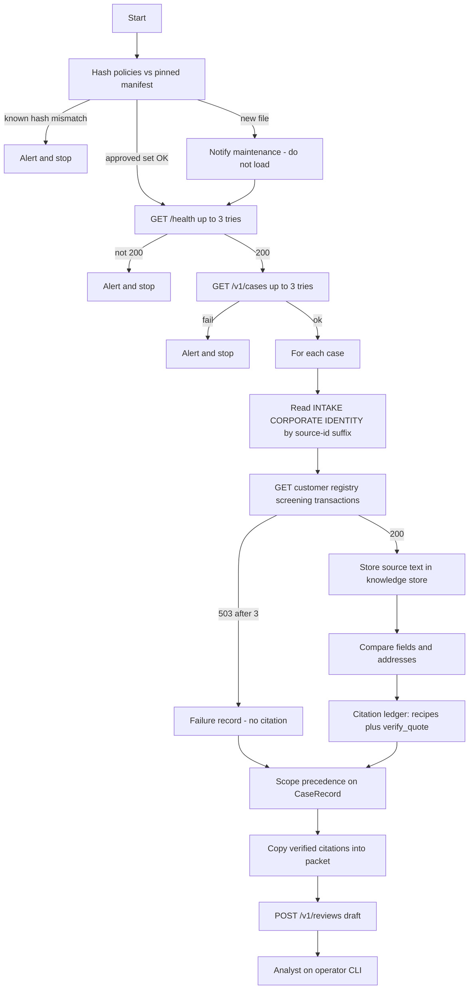

# Architecture — KYC Review Copilot

The copilot prepares a draft periodic-review packet for a human analyst. It never approves or rejects a customer and never creates a bank record.

**Authorities:** ENG-01 (product) → KYC-SCOPE-01 / dated policies → output contract.  
**Runtime sketch:** team whiteboard (hash → health → cases → evidence → ledger → scope precedence → packet → human).  
**Alignment notes:** [`ALIGNMENT.md`](ALIGNMENT.md).

## Pipeline (whiteboard-aligned)

Batch: one packet per case. Same business reference + same review date → reuse existing draft (ENG-01).

## Layers

| Layer | Responsibility |
|---|---|
| `contracts` | Frozen models: tools, documents, CaseRecord, reasons, packet, citations |
| `domain` | Compare, policy select, routing — no I/O, no clock, no model |
| `ingestion` | Markdown → models; policy manifest / folder hash |
| `adapters` | HTTP client, retries, redaction, SQLite knowledge store |
| `narrative` | Template DRAFT text from finished decision only |
| `observability` | Append-only traces and timings |
| `runner` | Startup health/cases, batch loop, review submit/poll |

## Citations (how we generate them)

1. **Store** full source text under `source_id` when ingesting docs/policies or fetching tools.  
2. **Decide** first (route, reasons, facts, discrepancies).  
3. **Recipes** from reasons: markdown line by prefix; tool JSON `"key": value` fragments.  
4. **Verify** `quote` is an exact substring of stored content; else drop.  
5. Failed tool → no citation for that source.  
6. Copy the verified list into packet `citations`. Optional `discrepancies` holds side-by-side values with quotes.

Not used on the graded path: LLM-proposed quotes, RAG over policies.

## Scope precedence (domain)

Compute signals first; then pick the highest route. Missing identity / address explanation **stay on the packet** even when escalating.

1. Unsupported pair → `escalate`, classification `unsupported`, policy ids = `KYC-SCOPE-01` only  
2. Registry unavailable / owners unknown → `escalate`, `owner_names` null  
3. Ownership depth > 1 → `escalate`  
4. Exact or near screening → `escalate` (do not confirm identity)  
5. Non-address field conflict (jurisdiction, entity ref, owner/holder, birth year) → `escalate`  
6. Else identity missing or address mismatch → `request_information`  
7. Else PEP or monthly total **strictly above** threshold → `enhanced_due_diligence`  
8. Else → `complete_review`

## Whiteboard / ENG-01 corrections

1. Review date is a calendar date (`YYYY-MM-DD`), never a timestamp.  
2. Quotes are exact substrings (no `12000` → `12000.0`).  
3. Registry may include `intermediate_entity` and `retrieved_at`.  
4. Unsupported combo is a business result, not a parse failure.  
5. Address mismatch → `address_explanation`; other conflicts escalate (ADR-0004).  
6. Missing corporate filing is not an address difference.  
7. Registry down → null owners; no registry citation.  
8. Currency must be `XCR` when transactions are present.  
9. Changed **known** policy hash → stop; **new** policy file → notify, do not auto-load.  
10. Intake “attached” but identity body says not included → identity missing; cite both.

## Decision boundaries

- Code chooses route, policy, facts, missing fields, discrepancies, citations.  
- Packet text is fixed/template code for submission.  
- Humans approve/reject drafts via operator CLI only.

## Fail closed

Shared retry: 3 attempts per call, then escalate or stop (startup). Do not invent empty screening or registry results. Do not fabricate citations for unavailable tools.
