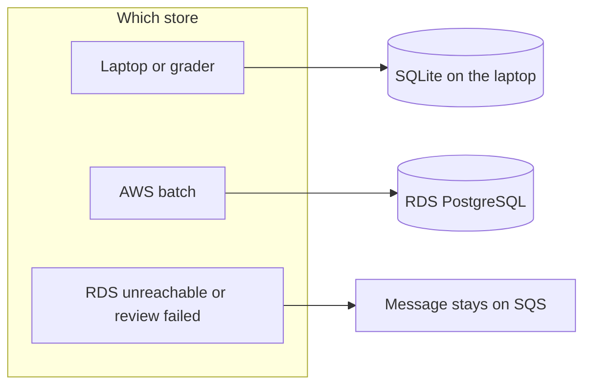
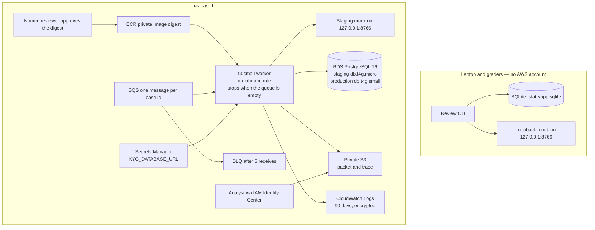
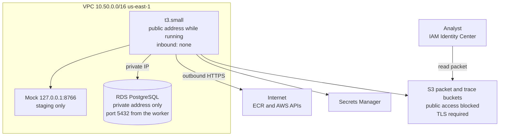
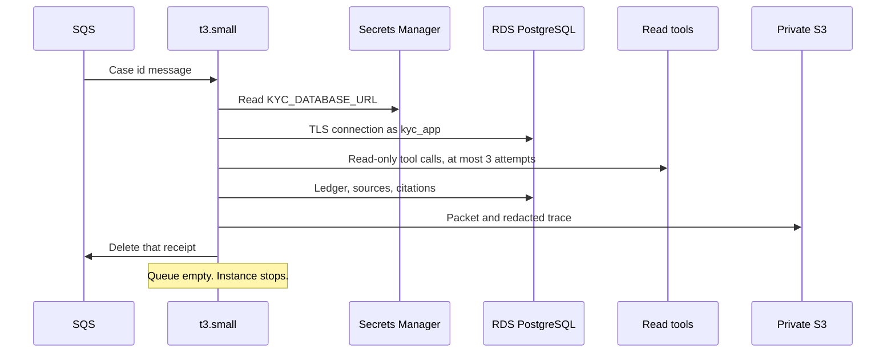
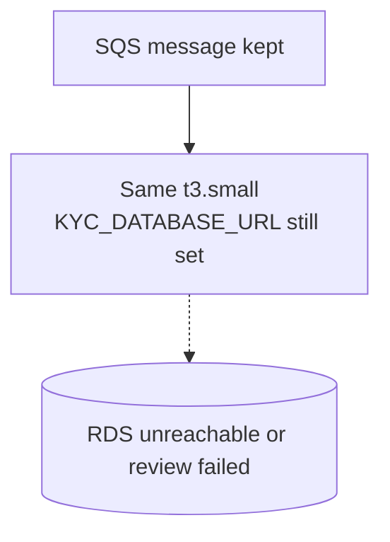
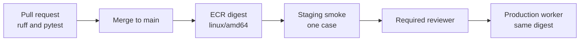

# Cloud deployment strategy — KYC Review Copilot

**Status:** Plan for a small production start. Not an ADR.
**Date:** 28 October 2026
**Region:** `us-east-1` only
**Supersedes:** the 27 October EC2 plan that kept SQLite as the cloud ledger.
**Does not replace:** [ADR-0005](adr/0005-model-and-deployment-strategy.md). If this plan and the ADR disagree, the ADR wins for the graded run. Graded runs stay local Docker Compose. This file is the AWS deployment.

This is the AWS shape for a startup-scale production: one batch worker, one private Postgres database, and a queue that holds a case when that database cannot be written.

## 1. Decision

Run each review on **one `t3.small`** in `us-east-1`. A case id waits on a queue. The instance starts, runs the waiting cases one at a time, and stops when the queue is empty. The copilot knowledge store is **RDS PostgreSQL 16** in the same VPC, with no public address. Finished packets and traces are copied to **private S3 buckets**. The image comes from **ECR**. Production pulls a digest only after a person approves it.

There is **no NAT gateway**, no interface endpoint, no load balancer, no Fargate service, no Lambda, no Aurora, and no second region.

If Postgres cannot be reached, or the review fails before the packet and the trace are stored, the SQS message **stays on the queue**. The worker does not unset `KYC_DATABASE_URL`, does not open SQLite, and does not delete the message. A message moves to the dead-letter queue only after five receives. The SQLite file remains the laptop and grader path.



## 2. Why this shape

The program is already a batch. `python -m kyc_copilot` takes case ids, calls the read tools, decides a route in code, and exits. A person accepts the draft. The pipeline does not approve a customer and does not create a bank record.

| Choice | What it is for | What it avoids |
|---|---|---|
| One `t3.small`, start then stop | Runs the command that already exists | A fleet, a website, SSH |
| RDS PostgreSQL 16, single-AZ | The cloud ledger Diego approved: backups, TLS, a dedicated user | SQLite on EBS as the production book of record |
| Public address on the worker only, no inbound rule | Outbound calls to AWS and to the tool host without a NAT gateway | About $32 a month per NAT |
| Private RDS in the same VPC | The worker reaches the database on a private address | A public database |
| S3 for packets and traces | The analyst handoff | Using the bucket as the ledger |
| Hold the SQS message | A failed or unstored case is not written to a second database | A cloud SQLite copy of the ledger |
| One account, two stacks | Staging and production at this scale | A second account until the bank requires it |

Postgres removes the old limit that two processes must never open one SQLite file. The operating rule is still **one in-flight run per case** and **one consumer on the queue**. Five sequential reviews fit one writer. A second worker is a later capacity change, not part of this phase.

Cloud Run plus Cloud SQL remains the non-AWS reference in ADR-0005. Use that reference when there is no AWS account. Inside this account, the EC2 worker plus RDS is the deployment.

## 3. What is being deployed

The worker ingests the approved policies, reads documents by source-id suffix, calls the read tools, decides a route in code, and writes a draft packet whose citations are exact quotes.

This capstone has no separate bank tool host. Staging starts the same mock the image already contains, bound to `127.0.0.1:8766` on the worker, and the review container shares the host network so it can call that address. Production has no path to the mock. The mock's `mock.sqlite` stays on the host that runs the mock. It is not the copilot ledger and it is not copied into RDS.

Boundaries that stay inside the image:

- Routing, policy selection, and facts stay in the domain layer. A model does not choose them. The graded path has no live model. Narrative text is the fixed template.
- A tool call retries at most three times, then the case escalates. Escalation is a successful packet, not a failed run.
- `private_token` is removed before a trace, a log line, a metric, or an S3 object is written. Full document text is not stored in the knowledge store or the review log.
- A known policy hash that does not match the manifest stops the run. A new policy file raises a maintenance warning and is not loaded.
- Review dates come from intake. The worker does not ask the clock for them.
- The worker may post a draft for a person (`--submit-reviews` to `/v1/reviews`). It has no approve operation and it does not call `POST /v1/records`.
- The store factory selects the engine. `--dsn`, then `KYC_DATABASE_URL`, then `--db`. A `postgresql://` or `postgres://` URL opens Postgres. A remote host gets `sslmode=require` unless the URL already sets `sslmode`. The factory refuses `mock.sqlite`. A failed Postgres connection does not open another file. The CLI exits with "The knowledge store could not be opened. Nothing was written to another database." and does not print the URL.

The container image is Python 3.12 with `pydantic` and `psycopg[binary]`, locked by `uv`. It does not add SQLAlchemy, asyncpg, `requests`, or `httpx`. The Dockerfile default command starts the mock server. The cloud review **overrides that command**. The cloud task runs as user `kyc` (uid 1000). The image does not set `USER`, so a laptop Compose bind mount can still be written by root.

## 4. Target architecture

One workload account, pinned to `us-east-1`. Non-production and production are two stacks in that account: separate instance, database, secret, queue, and buckets. Nothing in staging reads production. A second AWS account waits until the bank requires that isolation.

GitHub Actions already builds and tests the image. The delivery half publishes the digest to a private ECR repository. Production has a required reviewer. There are no long-lived access keys in the repository.



| Piece | Service | Where it sits |
|---|---|---|
| Image | ECR, tag is the git SHA, tags immutable, scan on push | `us-east-1`, private |
| Queue | SQS, one message per case id, visibility 300 seconds | One consumer. A second consumer is not started. |
| Dead letter | SQS, redrive after 5 receives | The case is still not written to SQLite. |
| Worker | One `t3.small`, Amazon Linux, `linux/amd64` | Public subnet. No inbound rule. Stopped between batches. |
| Staging tool | The image's mock, `--network host`, user `kyc` | Loopback on the worker. Production does not start it. |
| Copilot store | RDS PostgreSQL 16 | Private subnets of the same VPC. Not publicly accessible. |
| Packet and trace | S3, public access blocked, versioned, SSE-KMS | Analyst handoff. Not the ledger. |
| Database URL | Secrets Manager `kyc/<stack>/database` | Read at start. Not baked into the image. The worker cannot read the master secret. |
| Alerts | CloudWatch Logs, metric filters, alarms | The log remains after the instance stops. |
| Release gate | GitHub environment named `production` | Required reviewer. |
| Operator access | IAM Identity Center | Hourly session. No long-lived keys in the repo. |

Staging uses **`db.t4g.micro`**. Production uses **`db.t4g.small`** and is not created until the staging smoke case passes.

## 5. Network

This account has no default VPC. The staging VPC is `10.50.0.0/16`, with DNS hostnames on, an internet gateway, and two public subnets (`10.50.1.0/24` in `us-east-1a`, `10.50.2.0/24` in `us-east-1b`). There is no NAT gateway. Other teams' VPCs, databases, and queues are left alone.

The worker has one public IPv4 address while it is running. The security group has **no inbound rule**. Outbound HTTPS reaches ECR, SQS, S3, Secrets Manager, CloudWatch, and RDS stays on the private route. Systems Manager is the operator path. There is no SSH key. IMDSv2 is required.

RDS has **no public address**. Its security group allows TCP 5432 only from the worker security group.



| Path | What it is for | What it costs |
|---|---|---|
| Public address on the worker | Outbound calls while a batch is running. Released when the instance stops. | About $4 a month if the instance is left on |
| No inbound rule | Nothing on the internet can open a connection to the worker | No charge |
| Private route to RDS | Ledger traffic stays in the VPC | No NAT charge |
| Systems Manager | An operator session during an incident | No charge |
| S3 bucket policy | Refuses public access and non-TLS | No charge |

A private worker with no address of its own would need a NAT gateway to pull the image and call AWS APIs. Closing inbound on this instance is the route that keeps those calls and refuses inbound connections.

## 6. Batch lifecycle

On each boot the worker logs in to ECR, pulls the pinned image, and on staging starts the mock on the host loopback. It reads `kyc/<stack>/database`, exports `KYC_DATABASE_URL` in the process environment, and drains the queue. The URL is passed to Docker by variable name. It is not written into the container arguments, user-data, or the log.



Exit codes for one receive:

| Code | Meaning | Message | Instance |
|---|---|---|---|
| 0 | One case reviewed, copied, and deleted | Deleted | Continues until the queue is empty |
| 1 | Receive, review, copy, or delete failed | Stays | Stays up so the failure can be inspected |
| 2 | Refused before AWS: URL missing, URL not Postgres, or queue URL missing | Untouched | Stays up |
| 3 | Queue empty | None | Stops |

Copy runs only when the output directory and both bucket names are set. A partial copy configuration returns 1 and does not delete the message. S3 keys are `results.json` and `trace.jsonl` at the bucket root.

One run is in flight for a given case. An identical draft reuses the review id and does not post again. The ledger key stays the case id plus the SHA-256 of the canonical draft.

## 7. Data

Three stores, three jobs. The mock bank's SQLite file is a fourth store and it is not the copilot ledger.

| Store | Holds | Does not hold |
|---|---|---|
| RDS PostgreSQL | Policies, source text used for citations, tool evidence, review ledger | The analyst's copy of the packet, `private_token`, the mock bank |
| S3 | Finished packet and trace archive | The ledger, the policy rows, a live database file |
| CloudWatch | Redacted trace events and the metrics line | Document bodies and `private_token` |
| SQLite on the laptop | The grader and Compose-off path | Production rows |

`review_ledger.json` is a JSON file beside the packet. It is not a table inside SQLite or RDS.

### Database

| Setting | Staging | Production |
|---|---|---|
| Identifier | `kyc-staging` | Not created until staging smoke passes |
| Engine | PostgreSQL 16 | PostgreSQL 16 |
| Class | `db.t4g.micro` | `db.t4g.small` |
| Availability | Single-AZ | Single-AZ |
| Public access | Off | Off |
| Storage | 20 GB gp3, encrypted with a customer-managed KMS key | 20 GB gp3, same key family |
| Backups | Automated, 7 days | Automated, 7 days, and one restore drill before real cases |
| Database name | `kyc` | `kyc` |
| Runtime user | `kyc_app`: `NOSUPERUSER`, `NOCREATEDB`, `NOCREATEROLE`, `CONNECT` on `kyc`, `USAGE` and `CREATE` on schema `public` | Same |
| Master user | `kyc_admin`, stored separately, not readable by the worker after bootstrap | Same |
| TLS | `sslmode=require` | Same |
| Deletion protection | Off on staging so the stack can be removed | On |

The production database **stays on**. A stopped RDS instance starts itself again after 7 days. Staging may be stopped between tests. The case stays on the queue while it is stopped. Do not copy `app.sqlite` or `mock.sqlite` into RDS.

Multi-AZ is the later upgrade, when an analyst cannot wait for a restore. Aurora is not the idle choice: its minimum capacity costs more than `db.t4g.small` at this load.

### S3

- One packet bucket and one trace bucket per stack.
- Block public access. Deny any request that is not TLS.
- Version every object. Encrypt with the stack's customer-managed key.
- Move traces to infrequent access after 90 days. Customer-text retention follows the bank's schedule.
- A new object under a policy prefix does not become an active policy. Ingest still refuses a hash that is not on the manifest.

Staging names: `kyc-staging-packets-104005345381` and `kyc-staging-traces-104005345381`.

If the bucket is lost, the run can be repeated from the database. If the database is lost, the bucket is not a substitute.

### What the application already does

```text
--dsn  wins
else KYC_DATABASE_URL
else --db   (local default: .state/app.sqlite)
```

`mock.sqlite` is refused. Localhost does not force `sslmode`. Any other host does. The cloud worker accepts only a `postgres://` or `postgresql://` URL. Anything else exits before it calls AWS.

## 8. When the database or the review fails

The case stays on the queue. That is the whole fallback.



**Database paused or unreachable.** Leave `KYC_DATABASE_URL` set. Do not start a review against a file. The message remains visible again after the visibility timeout. After five receives it moves to the dead-letter queue. It is still not loaded into SQLite.

**Review or copy fails.** The receipt is not deleted. The instance stays running so the log can be read. A replacement instance uses the same image digest, the same secret, and the same RDS endpoint.

**Queue empty.** The worker exits 3, removes the staging mock, and stops the instance. A stopped worker has no compute charge.

Do not add a second RDS, Aurora, Fargate, or another region as the fallback.

## 9. Options set aside

| Option | Why it is not this phase |
|---|---|
| App Runner | Expects a listening HTTP service. The CLI exits when the batch finishes. A private database needs a VPC connector that you pay for while idle. |
| Lambda | A review batch can pass the 15-minute limit. A VPC-attached function cold-starts on every run. |
| ECS Fargate in private subnets | Private tasks need a NAT gateway or interface endpoints. That is the hundreds-of-dollars layout this plan rejects. |
| EKS | A control plane for one batch container. |
| Elastic Beanstalk | A long-running web platform for a program that is not a website. |
| Aurora Serverless | Minimum capacity costs more at idle than `db.t4g.small`. |
| Multi-AZ RDS | About twice the database bill. Add it when restore time is no longer acceptable. |
| SQLite on EBS as the cloud ledger or the cloud fallback | A second writer of the same cases. The file stays on the laptop. |
| Bedrock, SageMaker, Rekognition, Textract, Comprehend, Transcribe | The graded path has no model. A future narrative model, if approved, must be US-built and must not choose route, policy, or facts. |

## 10. Security baseline

- RDS encryption at rest with the stack KMS key. S3 SSE-KMS with that key. EBS root volume encrypted. CloudWatch log group encrypted.
- Database not publicly accessible. Worker security group has no inbound rule. No SSH key. IMDSv2 required.
- `KYC_DATABASE_URL` lives in Secrets Manager. The instance role can read the application secret, pull the image, write the two bucket prefixes, use the queue and its dead-letter queue, and decrypt with the stack key. It cannot read the master secret, call `GetRandomPassword`, or administer IAM.
- The URL is injected as an environment variable at start. It is not in the image, a committed env file, or user-data. The drain script does not run with `set -x`.
- `kyc_app` is not a superuser and cannot create databases or roles.
- CloudTrail records management events. Both buckets block public access.
- The image is scanned on push. Tags are immutable. Production pulls a pinned digest.
- The build fails if an unapproved model name appears in configuration, once that configuration exists.
- Production has no path to the mock.
- Analyst access to the packet bucket goes through IAM Identity Center.

Two gaps stay visible. Image signing is not in the first release. The registry scan and the pinned digest are. A bank change ticket, beyond the GitHub reviewer, is the bank's process. This design records the reviewer and the digest.

### Access in this organization

Sign-in is IAM Identity Center. Sessions expire. Run `aws sso login` again when the token expires. Do not copy long-lived access keys into the repository or into chat.

`AWSPowerUserAccess` can build services and cannot create IAM roles. The staging instance profile was created during an administrator session. Do not work around a deny, and do not change Control Tower or another team's resources.

This system uses **`us-east-1` only**.

## 11. Release

A pull request runs the CI workflow already in the repository: a locked install, ruff, and the full suite. A pull request does not push an image.



- A merge to `main` builds `linux/amd64`, scans the image, and pushes the digest to ECR. Tags are the git SHA. Tags cannot be moved.
- Staging pulls that digest. The smoke message is `KYC-D01`. The check requires a packet in the staging packet bucket, a trace with no `private_token` and no document body, the message deleted only after that copy, and the instance stopped. `alert=false` on the metrics line.
- The production GitHub environment has a required reviewer. The production instance pulls that digest only after the approval. Reviewer usernames are still to be named.
- Rollback pulls the previous digest. The database is not rebuilt as part of an image rollback.

## 12. Observability

The worker keeps writing the events it writes today. Payloads, document text, and `private_token` are not fields on those lines. The instance ships stdout to a KMS-encrypted log group kept for 90 days. A metric filter turns the metrics line into CloudWatch metrics. The drain log on the host is `/var/log/kyc-drain.log`.

| Event | What is stored |
|---|---|
| `tool_call` | Case id, tool, attempt, status, latency, circuit |
| `decision` | Case id, routing, classification, reasons, missing information, policy ids, latency |
| `metrics` | Cases, success rate, p95, SLO of 15000 ms, alert, alert reason |

Page the on-call reviewer when any of these is true:

- Success rate over the last 20 decisions is under 95 percent.
- p95 time to packet is over 15 seconds.
- The review process exits non-zero.
- RDS free storage is under 20 percent, or the newest automated backup is older than 36 hours.
- The dead-letter queue is not empty.

Before the next group of analysts is added, read the route mix, the escalation rate, the duplicate rate, and RDS CPU and connections. Those numbers say whether one worker is still enough.

## 13. Cost

List-price estimates for `us-east-1`, not a quote. A month is 730 hours.

| Line | Left on all month | Stopped between batches |
|---|---|---|
| One `t3.small` | about $15 | hours actually run |
| One public IPv4 | about $4 | released when the instance stops |
| 20 GB gp3 for the OS disk | about $2 | about $2 |
| RDS `db.t4g.micro` (staging) | about $12–15 plus about $2 storage | storage only while stopped, 7-day limit |
| RDS `db.t4g.small` (production) | about $24–30 plus about $2 storage | production stays on |
| S3, ECR, SQS, KMS, Secrets Manager, CloudWatch | a few dollars | a few dollars |
| NAT gateway | not in this plan | not in this plan |

| Way of running | Rough month |
|---|---|
| Graders and laptops, SQLite only | $0 |
| Staging database on, worker stopped | about $15–20 |
| Production database on, worker stopped | about $30–40 |
| Staging and production databases on, both workers stopped | about $45–70 |
| The rejected private-subnet layout | NAT about $32 each, plus interface endpoints |

## 14. How load is answered

The current planning figure is five reviews in a day, one worker, one case at a time. A single case is a short batch except when a tool is retried. The ceiling shows up first at the tool API, then at one sequential worker, not at CPU.

| Signal | Response |
|---|---|
| More cases in a day, still inside the day | Keep one worker. Watch p95. |
| RDS CPU or memory is the limit, connections still low | Change the instance class. Same endpoint, same secret. |
| Cases queue behind one another past the business day | Then consider a second consumer. Postgres can take it. Do it as its own change, with one in-flight run per case still enforced. |
| Free storage under 20 percent | Grow RDS storage in place. |
| More analysts need the packet | Add them in Identity Center. Same bucket. |
| Upstream tool errors dominate the alerts | A larger instance will not fix it. |
| Restore time is unacceptable | Move production RDS to Multi-AZ. |
| Worker dies | Replace the instance from the same digest. The message is still on the queue. |

Growth in this phase does not add a load balancer, a second region, or a new database engine.

## 15. Staging record

Built in account `104005345381`, `us-east-1`, and not yet proven with a case:

- VPC `10.50.0.0/16`, worker security group with zero inbound rules, database security group open to the worker on 5432.
- Queue `kyc-staging-cases` and its dead-letter queue. Last check: empty.
- RDS `kyc-staging`, PostgreSQL 16, `db.t4g.micro`, private, database `kyc`, user `kyc_app`.
- Secrets `kyc/staging/database` (worker) and `kyc/staging/database-admin` (master, worker cannot read it).
- ECR repository `kyc-copilot`, immutable tags, scan on push.
- Worker `kyc-staging-worker`, `t3.small`, stopped. The boot script on the instance is the earlier drain. It does not start the mock and it does not run as `kyc`.
- Image tag `aaab412` is the worker that starts the mock, shares the host network, runs as `kyc`, and holds a failed message. It is committed locally and not yet in ECR.
- Production stack, GitHub OIDC, and the required reviewers are not created.

The next staging action, after the `kyc-iam` session is refreshed, is to push `aaab412`, install `deploy/kyc-drain.sh`, send `KYC-D01`, start the instance, and apply the checks in section 17. A failure leaves the message on the queue.

## 16. Order of work

1. Confirm `aws sts get-caller-identity` on the operator profile. Sign in again when the token expires.
2. KMS key, VPC, subnets, security groups, staging RDS, and the `kyc_app` user. Store the URL in `kyc/staging/database`. Confirm the endpoint is not public.
3. Queue, dead-letter queue, private buckets, ECR. Confirm the worker security group has no inbound rule.
4. Push the git SHA to ECR as an immutable tag. Point the boot script at that tag.
5. Send `KYC-D01`. Start the instance. Pass means a packet in the staging bucket, a trace with no `private_token`, the message deleted only after the copy, and the instance stopped.
6. Run one case whose draft is already known. The same draft must reuse the review id and must not post a second time.
7. Restore drill from the automated backup onto a staging snapshot. Do this before production holds a real case.
8. Name the production reviewers. Create the production stack: empty `db.t4g.small`, same digest, required reviewer.
9. Leave the production database running. Stop the workers when the queue is empty.

Do not copy `app.sqlite` or `mock.sqlite` into RDS. The laptop Compose stack remains for development. It does not hold the production database.

## 17. Cutover checks

| Check | Pass means |
|---|---|
| RDS reachability | No public address. Port 5432 accepts the worker security group only. |
| TLS | A remote DSN connects with `sslmode=require`. |
| Runtime user | `kyc_app` can install and write copilot tables and cannot create a database. |
| Worker from the internet | No inbound rule. No SSH key. No task left running after the queue drains. |
| Failed review | The message is still on the queue or the dead-letter queue. No SQLite file was opened. `KYC_DATABASE_URL` is still set. |
| Trace and packet | No `private_token` and no document body. |
| Identical draft | Same review id, no second post. |
| Bank writes | No `POST /v1/records`. Drafts only. |
| Mock | Staging calls `127.0.0.1:8766` on the worker. Production does not start the mock. `mock.sqlite` is not the store. |
| Metrics line | `alert=false`, p95 under 15 seconds on the smoke case. |
| Access | Only the named reviewers can read the production bucket. |
| Image | Production digest equals the digest staging already ran. |

## 18. Controls that stay

- One region. `us-east-1`.
- No inbound access to the worker.
- No NAT gateway and no interface endpoint in this phase.
- S3 remains an output copy.
- One in-flight run per case. One queue consumer until section 14 says otherwise.
- Three tool attempts, then escalate.
- `private_token` and full document text are never stored.
- New policy files are not auto-loaded.
- A person approves the production image, and a person accepts the review.
- Routing stays in code.
- Graders run without AWS, on SQLite.
- Recommendations stay drafts. The worker does not create a bank record.

## 19. Controls that changed on 28 October 2026

The cloud ledger is RDS PostgreSQL, not the SQLite file on the instance disk.

The cloud fallback is the queue. If the database cannot be written, or the packet cannot be stored, the message stays where it is. The worker does not open SQLite and does not unset `KYC_DATABASE_URL`.

Staging calls the capstone mock on the worker loopback. Production does not.

## 20. Related documents

- [ADR-0005](adr/0005-model-and-deployment-strategy.md) — model rules and the accepted local submission target
- [RUNBOOK](RUNBOOK.md) — how to run Compose, SQLite, and `KYC_DATABASE_URL`
- [ARCHITECTURE](ARCHITECTURE.md) — layer boundaries
